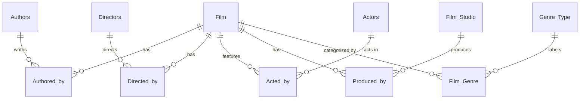

# Relational Database Systems

Relational database modeling, CSV-to-relational preprocessing, SQL querying, and integrity analysis using a film and awards dataset. The repository brings together the executable portions of several database exercises: schema design, many-to-many relationships, query logic, and data validation.

## Implementations

| Area | Implementation | Focus |
| --- | --- | --- |
| Relational schema and ETL | [Schema and ETL](schema-and-etl/README.md) | Primary/foreign keys, relationship tables, input normalization, CSV generation |
| SQL queries | [SQL queries](sql-queries/README.md) | Joins, filtering, grouping, and query formulation |
| Aggregate queries | [Movie duration query](query-optimization/README.md) | Aggregate-and-join query for minimum duration within each year |
| Data integrity | [Transaction checks](data-integrity/README.md) | Contradictions across repeated transaction, product, and customer attributes |

## Schema

The main schema separates films, authors, directors, actors, studios, and genres. Junction tables represent film-to-person and film-to-category relationships.



## Technical focus

- **Data modeling:** normalized entity tables, composite keys, foreign-key constraints, and relationship tables.
- **Data pipelines:** parsing denormalized film records and generating relation-specific CSV files with Python.
- **Relational queries:** composing SQL queries across multiple relations, aggregate filtering, and result ordering.
- **Data consistency:** expressing conflicting attribute combinations as SQL predicates.
- **Query analysis:** reasoning about relational operations and query cost in the associated coursework; executable examples are limited to the included SQL.

## Running the code

The schema uses PostgreSQL-style SQL, including `CASCADE` in the drop script. An appropriate PostgreSQL environment is recommended. To create the schema:

```powershell
psql -d movies -f .\schema-and-etl\create.sql
```

The preprocessing script expects an **external** `oscars.zip` archive containing `oscars.csv` in its working directory. It writes CSV files for the resulting relations. Its relative paths and input-column assumptions are those of the original dataset.

```powershell
cd schema-and-etl
python ex1.py
```

The other queries expect their corresponding `Movies` or `sales` tables. Those datasets and table definitions are not bundled, so these scripts are reference implementations unless the matching database is available.

**Caution:** `drop.sql` files contain destructive operations and should only be executed against a disposable database.

## Scope

The repository retains the original executable implementations. It does not include lecture slides, graded submissions, third-party datasets, or the written-only relational algebra exercises. The SQL snippets have not been verified against a live PostgreSQL instance in this archive.
